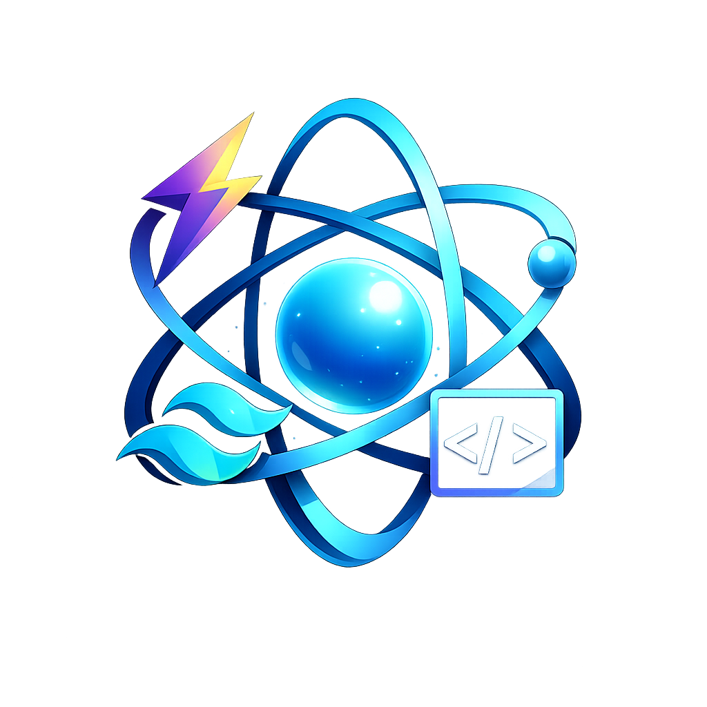

<div align="center">
  
  
  # Assent Dashboard

  <p>
    <strong>Una solución de gestión empresarial moderna, rápida y elegante.</strong>
  </p>

  <p>
    <a href="https://github.com/miguelnexs/Assent/graphs/contributors">
      
    </a>
    <a href="">
      
    </a>
    <a href="https://github.com/miguelnexs/Assent/network/members">
      
    </a>
    <a href="https://github.com/miguelnexs/Assent/stargazers">
      
    </a>
    <a href="https://github.com/miguelnexs/Assent/issues">
      
    </a>
    <a href="https://github.com/miguelnexs/Assent/blob/main/LICENSE">
      
    </a>
  </p>

  <p>
    <a href="#características">Características</a> •
    <a href="#instalación">Instalación</a> •
    <a href="#uso">Uso</a> •
    <a href="#tecnologías">Tecnologías</a> •
    <a href="#contribuir">Contribuir</a>
  </p>
</div>

<br />

> **Assent Dashboard** es una aplicación de escritorio multiplataforma diseñada para ofrecer una experiencia de usuario excepcional. Construida con las últimas tecnologías web y nativas, combina la potencia de Electron con la flexibilidad de React y la belleza de Tailwind CSS.

## ✨ Características

- 🎨 **Interfaz Moderna y Minimalista**: Diseño limpio utilizando `shadcn/ui` y componentes personalizados.
- 🌓 **Modo Oscuro/Claro**: Soporte nativo para cambio de tema con persistencia.
- 🪟 **Diseño Frameless**: Barra de título personalizada totalmente integrada con controles de ventana nativos.
- ⚡ **Alto Rendimiento**: Optimizada con Vite para tiempos de carga instantáneos.
- 🖥️ **Multiplataforma**: Compatible con Windows, macOS y Linux.
- 🔒 **Seguridad**: Implementación segura de IPC (Inter-Process Communication) y Context Isolation.

## 🛠️ Tecnologías

Este proyecto está construido sobre un stack robusto y moderno:

<div align="center">

| Tecnología | Descripción |
| :---: | :--- |
|  | **Electron** - Runtime para aplicaciones de escritorio |
|  | **React** - Librería para interfaces de usuario |
|  | **TypeScript** - Tipado estático para JavaScript |
|  | **Tailwind CSS** - Framework de utilidades CSS |
|  | **Vite** - Herramienta de construcción ultrarrápida |

</div>

## 🚀 Instalación

Sigue estos pasos para configurar el proyecto en tu máquina local.

### Prerrequisitos

Asegúrate de tener instalado:
*   [Node.js](https://nodejs.org/) (versión 16 o superior)
*   [Git](https://git-scm.com/)

### Pasos

1.  **Clonar el repositorio**
    ```bash
    git clone https://github.com/miguelnexs/Assent.git
    cd Assent
    ```

2.  **Instalar dependencias**
    ```bash
    npm install
    ```

3.  **Iniciar en modo desarrollo**
    ```bash
    npm run dev
    ```

## 📦 Construcción (Build)

Para generar el ejecutable para tu sistema operativo:

```bash
npm run build
```

Los archivos generados se encontrarán en la carpeta `dist`.

## 📂 Estructura del Proyecto

```bash
Assent/
├── 📁 src/
│   ├── 📁 main/        # Proceso principal de Electron
│   ├── 📁 preload/     # Scripts de precarga y puente seguro
│   └── 📁 renderer/    # Aplicación React (Frontend)
│       ├── 📁 assets/  # Imágenes y recursos estáticos
│       ├── 📁 components/ # Componentes UI reutilizables
│       └── 📁 layouts/ # Estructuras de página
├── 📁 resources/       # Iconos y recursos del sistema
└── 📄 electron-builder.yml # Configuración del instalador
```

## 🤝 Contribuir

¡Las contribuciones son bienvenidas! Si tienes ideas para mejorar Assent Dashboard:

1.  Haz un Fork del proyecto.
2.  Crea una rama para tu característica (`git checkout -b feature/AmazingFeature`).
3.  Haz Commit de tus cambios (`git commit -m 'Add some AmazingFeature'`).
4.  Haz Push a la rama (`git push origin feature/AmazingFeature`).
5.  Abre un Pull Request.

## 📄 Licencia

Distribuido bajo la licencia MIT.

---

<div align="center">
  Hecho con ❤️ por <a href="https://github.com/miguelnexs">Miguel</a>
</div>
